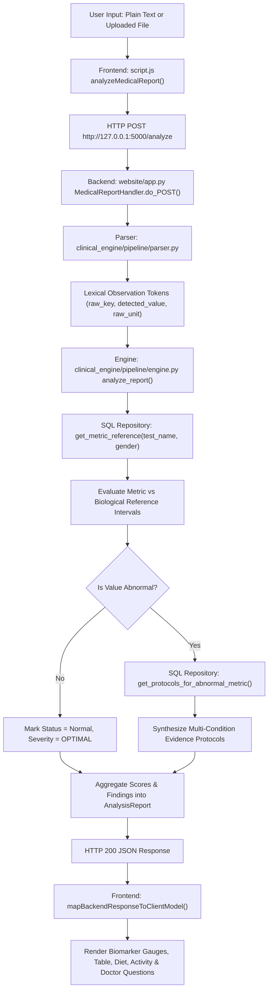
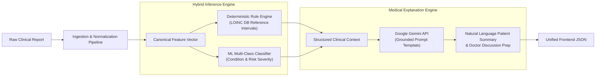

# PHASE 1: COMPLETE TECHNICAL AUDIT REPORT
## MediPulse AI — Medical Report Analyzer

---

## 1. Executive Summary

MediPulse AI is currently structured as a full-stack clinical prototype designed to ingest laboratory diagnostic reports, extract biomarker values, and display evaluations, gauges, and lifestyle/escalation recommendations.

In recent development work, the backend was refactored into a decoupled domain-driven architecture under `clinical_engine/` and backed by a local SQLite relational database (`data/clinical_knowledge.db`). However, the system currently:
1. **Lacks genuine Machine Learning (ML)**: There are no trained weights, loss functions, scikit-learn models, gradient-boosted trees, or neural networks. Diagnostic logic is purely deterministic and threshold-based.
2. **Lacks Generative LLM Integration**: There is no live Gemini API integration or dynamic conversational reasoning engine. The frontend assistant relies on static string templates and client-side echo logic.
3. **Contains Incomplete Biomarker Coverage**: Across the four target clinical profiles (**CBC**, **Lipid Profile**, **Diabetes Profile**, and **Kidney Function Test / KFT**), several vital markers are missing (e.g., MCHC in CBC; Random Glucose in Diabetes; Blood Urea vs. BUN distinction in KFT).
4. **Relies on Regex Heuristic Parsing**: The text extraction pipeline is regex-dependent, making it fragile when presented with varying lab formats, multi-column layouts, tabular OCR noise, or mismatched units.

This audit provides a comprehensive, evidence-based breakdown of all code modules, database tables, missing dependencies, and architectural requirements needed to transition MediPulse AI into an ML-enabled, data-driven healthcare software platform.

---

## 2. Existing Project Architecture

### 2.1 Workspace Organization
The project repository contains two nested levels:
```
report_analyser/
├── package.json                        # Root workspace config (Vite 8 build scripts)
├── package-lock.json                   # Root lockfile
├── clinical_engine/                    # Modular Python backend package
│   ├── domain/                         # Type-safe schemas and data contracts
│   │   ├── __init__.py
│   │   └── schemas.py                  # LabMetric, ClinicalProtocol, ClinicalFinding, AnalysisReport
│   ├── pipeline/                       # Ingestion and processing pipeline
│   │   ├── __init__.py
│   │   ├── parser.py                   # Regex token extractor (ParsedObservation)
│   │   └── engine.py                   # Diagnostic decision support engine
│   └── storage/                        # Persistence and repository pattern
│       ├── __init__.py
│       └── repository.py               # Abstract ClinicalRepository & SQLite implementation
├── data/                               # Clinical knowledge storage
│   ├── canonical_clinical_dataset.json # Seed dataset containing 31 metrics and 6 protocols
│   ├── canonical_clinical_dataset.py   # Dataset builder script
│   └── clinical_knowledge.db          # Active SQLite database (31 metrics, 6 protocols, 15 mappings)
├── medical-report-analyser/            # Web application directory
│   ├── package.json                    # Nested web app package definition
│   ├── package-lock.json
│   ├── README.md                       # Project documentation
│   └── website/                        # Frontend and HTTP server assets
│       ├── index.html                  # Single-page user interface
│       ├── style.css                   # Custom styles, glassmorphism UI & responsive design
│       ├── script.js                   # Client-side gateway, fallback tokenizer, and DOM renderer
│       ├── app.py                      # Python BaseHTTPRequestHandler server (port 5000)
│       └── dist/                       # Vite compiled production bundle
├── scripts/
│   └── seed_clinical_data.py           # CLI database ingestion and validation utility
├── tests/
│   └── test_clinical_engine.py         # Unit & integration test suite (6 passing tests)
└── reports/
    └── phase_1_project_audit.md        # This technical audit report
```

### 2.2 Frameworks and Technology Stack
- **Frontend Framework**: Vanilla JavaScript (ES6+), semantic HTML5, CSS3 with custom variables and glassmorphism styling.
- **Frontend Build Tooling**: Vite 8.3.0.
- **Backend Framework**: Python standard library `http.server.HTTPServer` with `BaseHTTPRequestHandler` (Zero third-party web framework dependencies; no FastAPI or Flask).
- **Data Validation & Modeling**: Compatible with Pydantic (v1/v2 fallback) and standard Python `dataclasses`.
- **Database System**: SQLite 3 (`data/clinical_knowledge.db`), interacted with through Python's standard `sqlite3` library.
- **Testing**: Python standard library `unittest`.

---

## 3. Frontend Analysis

### 3.1 Medical Report Upload Functionality
- **Location**: `medical-report-analyser/website/index.html` (L234–L350), `medical-report-analyser/website/script.js` (L130–L180).
- **Supported File Formats**:
  - The dropzone accepts `.txt`, `.csv`, `.pdf`, `.png`, `.jpg`.
  - **Limitation**: The file reader (`FileReader`) in `script.js` reads files using `readAsText()`. For actual binary `.pdf` and image files, `readAsText()` outputs corrupted raw binary text into the text area because no client-side PDF parser (e.g., pdf.js) or OCR engine (e.g., Tesseract.js) is linked.
- **Direct Text Input**: Users can paste unstructured plain-text lab reports into the `<textarea id="report-text">`.

### 3.2 Biomarker Display & Analysis Result Components
- **Biomarker Table & Filter Pills**:
  - Defined in `index.html` (L433–L488) and dynamically populated by `renderBiomarkersTable()` in `script.js` (L295–L340).
  - Categorizes findings by status: *All*, *Out of Range*, and *Normal*.
  - Renders a multi-segment visual position meter (Low, Normal, High) with a proportional pip reflecting `gauge_percent` (0–100%).
- **Vital Metrics Grid & Health Score**:
  - Circle widget showing overall score (`#res-health-score`).
  - Chips summarizing total tested, in-range, flagged, and critical counts.
- **Actionable Guidance Panels**:
  - Diet & Lifestyle tab: Renders lists for Diet (`#rec-diet-list`), Activity (`#rec-activity-list`), and Items to Avoid (`#rec-avoid-list`).
  - Doctor Discussion tab: Renders bulleted physician escalation questions (`#doctor-questions-list`).

### 3.3 Chatbot Functionality
- **Location**: `medical-report-analyser/website/index.html` (L515–L550), `medical-report-analyser/website/script.js` (L355–L405).
- **Current Behavior**:
  - When the user sends a message, `sendChatMessage()` escapes the input and invokes a 300ms `setTimeout`.
  - It generates a static template string:
    > *"Regarding your inquiry on '[User Input]': All clinical guidelines and reference intervals are queried directly from the active evidence-based database. Please review flagged parameters with your healthcare provider for clinical confirmation."*
  - **No LLM API** is invoked. No conversational context or clinical Q&A occurs.

### 3.4 API Connections & Client Fallback
- In `script.js`:
  - `checkBackendHealth()`: Calls `GET http://127.0.0.1:5000/health`. If successful, sets status to green (*"Database Engine: Active (31 Biomarkers)"*).
  - `loadRegisteredMetrics()`: Calls `GET http://127.0.0.1:5000/metrics`.
  - `analyzeMedicalReport()`: Calls `POST http://127.0.0.1:5000/analyze` with `{ query, gender, age, category }`.
  - **Client-Side Fallback (`executeClientSideTokenizer`)**: If the backend server is offline or unreachable, `script.js` runs a regex on the text to extract tokens and displays an *"Unverified (Backend Offline)"* status, preserving user experience without crashing.

### 3.5 Frontend Components to Preserve
- **Glassmorphism Visual Identity & Theme Engine**: High-fidelity dark/light mode toggle with persistent `localStorage` storage.
- **Biomarker Result Table & Range Position Meters**: Excellent UI for clinical intuition (three-zone gradient bar).
- **Tabbed Navigation & Export Utilities**: Instant print stylesheet formatting (`window.print()`) and clipboard summary export.
- **File Dropzone & Text Switching Architecture**: Accessible dual-input mechanism.

---

## 4. Backend Analysis

### 4.1 Modular Architecture
The backend is organized into three distinct layers under `clinical_engine/`:
1. **Domain Layer (`clinical_engine/domain/schemas.py`)**:
   - Defines `LabMetric`, `ClinicalProtocol`, `ClinicalFinding`, `AnalysisReport`, `MetricStatus`, and `SeverityLevel`.
2. **Storage Layer (`clinical_engine/storage/repository.py`)**:
   - Implements `SQLClinicalRepository` adhering to the abstract `ClinicalRepository` interface.
   - Manages four relational tables: `lab_metrics`, `metric_aliases`, `clinical_protocols`, `condition_metric_mappings`.
3. **Pipeline Layer**:
   - `parser.py`: Lexical feature extractor.
   - `engine.py`: Orchestrator querying the database and synthesizing findings.

### 4.2 End-to-End Workflow Trace



#### Detailed Breakdown of Workflow Stages:
1. **User Upload**: User types/pastes text into `#report-text` or uploads a text file.
2. **Report Extraction (`parser.py`)**:
   - `ClinicalReportParser.parse_text()` processes the document line by line.
   - Applies regex `(?P<label>[A-Za-z0-9_\s\(\)\/\-\.]{2,40}?)\s*[:=\-]\s*(?P<value>[0-9]+(?:,[0-9]{3})*(?:\.[0-9]+)?)\s*(?P<unit>[A-Za-z\/%µu\^0-9]+)?`.
   - Produces `ParsedObservation` objects containing raw token strings and floats.
3. **Biomarker Identification (`repository.py`)**:
   - For each observation, `get_metric_reference(obs.raw_key, gender)` performs a normalized lookup against `metric_aliases` and `lab_metrics`.
   - Gender-specific ranges take precedence; if not found, falls back to `gender = 'all'`.
4. **Medical Analysis & Evaluation (`engine.py`)**:
   - Compares numeric value against `critical_low`, `min_normal`, `max_normal`, and `critical_high`.
   - Computes normalized slider percentage (`calculate_gauge_percent()`).
   - If abnormal, queries `condition_metric_mappings` to retrieve active `ClinicalProtocol` records.
5. **Result Generation**:
   - Generates an `AnalysisReport` object containing the health score (100 - penalties), risk stratification (*Low*, *Medium*, *High*), findings list, protocol citations, diet, activity, and physician escalation questions.
6. **Frontend Display (`script.js`)**:
   - Maps JSON response to UI view models and updates DOM elements.

---

## 5. Hardcoded and Dummy Data Inventory

The previous refactoring removed static sample cases and hardcoded dictionary lookups from runtime execution. However, an audit of the current codebase reveals several remaining static heuristics and hardcoded components that must be reviewed before deploying real clinical datasets:

| Item # | File Path | Function / Component | Type of Hardcoded Data | Purpose | How It Currently Works | Why It Should Be Replaced / Reviewed | Recommended Future Implementation |
| :--- | :--- | :--- | :--- | :--- | :--- | :--- | :--- |
| **1** | `clinical_engine/pipeline/engine.py` | `analyze_report()` (L164–L165) | Hardcoded Scoring Heuristics | Computes patient health score (0–100) | `score = 100 - (abnormal*12) - (critical*16)` | Arbitrary linear formula without clinical validation; treats all abnormal markers with equal weight regardless of organ system. | Replace with clinically validated multivariate risk scoring (e.g., Framingham, ASCVD, KDIGO risk matrices). |
| **2** | `clinical_engine/pipeline/engine.py` | `analyze_report()` (L168–L175) | Hardcoded Risk Tiering | Assigns *Low*, *Medium*, or *High* priority | `critical > 0 or abnormal >= 3 -> High`, `abnormal > 0 -> Medium` | Oversimplified heuristic that does not account for acute organ risk vs. chronic minor variations. | Model-driven risk classification or clinically calibrated triage logic. |
| **3** | `clinical_engine/pipeline/engine.py` | `analyze_report()` (L197–L201) | Hardcoded Fallback Guidance | Default lifestyle recommendations | Hardcoded strings for normal/healthy reports (e.g., "Maintain a wholesome, balanced whole-foods diet...") | Static text in code rather than retrieved from an evidence-based knowledge base. | Store baseline wellness protocols in database tables or retrieve dynamically via Gemini API. |
| **4** | `medical-report-analyser/website/script.js` | `executeClientSideTokenizer()` (L266–L275) | Hardcoded Fallback Narrative | Client-side fallback text | Static strings injected when backend is offline | Hardcoded placeholder messages | Display clear UI notification that offline evaluation is pending backend synchronization. |
| **5** | `medical-report-analyser/website/script.js` | `sendChatMessage()` (L385–L395) | Static Chatbot Template | In-app conversational response | Returns static boilerplate text acknowledging user message | Pure dummy response; no clinical reasoning or question answering occurs. | Integrate Google Gemini API with clinical retrieval-augmented generation (RAG). |
| **6** | `data/canonical_clinical_dataset.py` | `CLINICAL_KNOWLEDGE_PAYLOAD` (L12–L350) | In-Memory Reference Payload | Dataset definition script | Python dictionary compiling reference ranges and protocols to JSON | Python script rather than formal database migration files or verified external clinical datasets. | Replace with formal ETL pipeline reading validated medical reference datasets. |

---

## 6. Machine Learning Audit

### 6.1 Findings
- **Trained Model Files**: **None**. There are no `.pkl`, `.joblib`, `.h5`, `.onnx`, `.pt`, `.pth`, or `.bin` files in the repository.
- **Model Training Scripts**: **None**. No training loops, validation splits, cross-validation, or hyperparameter optimization routines exist.
- **Feature Engineering Pipeline**: **None**. There are no vectorizers, scalers (StandardScaler/MinMaxScaler), categorical encoders, or imputation mechanisms.
- **Model Evaluation**: **None**. No ROC-AUC, F1-score, confusion matrices, or precision/recall metrics.

### 6.2 Classification of Existing Processing Logic
To ensure strict technical clarity:
1. **Rule-Based Programming**: **100% of current diagnosis and evaluation logic**. The system evaluates numbers against upper and lower bounds (`val < min_normal`, `val > max_normal`).
2. **Statistical Processing**: Minimal (basic arithmetic for health index calculation).
3. **Machine Learning**: **0%**. No machine learning is currently present.
4. **LLM-Based Processing**: **0%**. No LLMs (Gemini, OpenAI, or local models) are currently connected.

---

## 7. API and Database Audit

### 7.1 Existing Backend API Endpoints (`medical-report-analyser/website/app.py`)
- `GET /health`:
  - Returns service status, database connectivity, total registered biomarkers, and active clinical protocols.
- `GET /metrics`:
  - Returns JSON list of all registered biomarkers and reference intervals.
- `POST /analyze`:
  - Receives payload: `{ "query": str, "gender": str, "age": str, "category": str }`.
  - Executes `DiagnosticEngine.analyze_report()` and returns structured `AnalysisReport` JSON.

### 7.2 External Service and LLM Integrations
- **Google Gemini API**: Not integrated.
- **External Auth**: None (no user accounts, session tokens, or JWTs).
- **CORS**: Implemented globally on all endpoints via `Access-Control-Allow-Origin: *`.
- **Environment Variables**: None used. Database paths and port numbers (`PORT = 5000`) are hardcoded.

### 7.3 Database Configuration (`data/clinical_knowledge.db`)
SQLite database containing:
- `lab_metrics` (31 records): Stores LOINC codes, canonical names, categories, units, reference limits, and critical limits.
- `metric_aliases` (42 records): Maps variations (e.g., "hgb", "hb", "haemoglobin") to primary `metric_id`.
- `clinical_protocols` (6 records): Stores evidence-based guidance, diet, activity, contraindications, and doctor questions.
- `condition_metric_mappings` (15 records): Maps condition IDs to metric IDs and trigger statuses.

---

## 8. Supported Medical Report Types & Dataset Requirements

The project will initially support four core clinical panels. An audit of existing database support versus required clinical standards reveals the following gaps:

### Panel 1: Complete Blood Count (CBC)
- **Required Biomarkers**: Hemoglobin, RBC, WBC, Platelets, MCV, MCH, MCHC, Hematocrit.
- **Currently Supported (Database)**:
  - Hemoglobin (`hemoglobin`, LOINC 718-7, g/dL)
  - RBC (`rbc`, LOINC 789-8, M/uL)
  - WBC (`wbc`, LOINC 6690-2, /uL)
  - Platelets (`platelets`, LOINC 777-3, /uL)
  - MCV (`mcv`, LOINC 787-2, fL)
  - MCH (`mch`, LOINC 785-6, pg)
  - Hematocrit (`hematocrit`, LOINC 4544-3, %)
- **Missing Biomarkers**:
  - **MCHC (Mean Corpuscular Hemoglobin Concentration)**: Not indexed in the database. Essential for evaluating spherocytosis, severe hypochromia, and cold agglutinin artifacts.
- **Required Units**: g/dL (Hb, MCHC), M/uL (RBC), /uL or x10^3/uL (WBC, Platelets), % (Hct), fL (MCV), pg (MCH).
- **Patient Context Needed**: Age, biological sex, smoking status, altitude, pregnancy status.
- **Potential Prediction Targets**: Microcytic Anemia, Macrocytic Anemia, Leukocytosis/Infection Suspicion, Thrombocytopenia.

### Panel 2: Lipid Profile
- **Required Biomarkers**: Total Cholesterol, LDL, HDL, Triglycerides.
- **Currently Supported (Database)**:
  - Total Cholesterol (`cholesterol_total`, LOINC 2093-3, mg/dL)
  - LDL (`ldl`, LOINC 13457-7, mg/dL)
  - HDL (`hdl`, LOINC 2085-9, mg/dL)
  - Triglycerides (`triglycerides`, LOINC 2571-8, mg/dL)
- **Missing Biomarkers**: None from core required set. (Optional extended markers: VLDL, Non-HDL Cholesterol, Total/HDL ratio).
- **Required Units**: mg/dL (US standard) or mmol/L (SI standard). *Unit conversion layer is required.*
- **Patient Context Needed**: Fasting duration (hours), statin therapy status, biological sex, age, diabetes status.
- **Potential Prediction Targets**: Atherogenic Dyslipidemia, Hypercholesterolemia, Hypertriglyceridemia, 10-year ASCVD Risk Category.

### Panel 3: Diabetes Profile
- **Required Biomarkers**: Fasting Glucose, Random Glucose, HbA1c.
- **Currently Supported (Database)**:
  - Fasting Glucose (`glucose_fasting`, LOINC 1558-6, mg/dL)
  - HbA1c (`hba1c`, LOINC 4548-4, %)
- **Missing Biomarkers**:
  - **Random Glucose**: Not currently indexed in the database.
- **Required Units**: mg/dL (or mmol/L) for glucose; % (or mmol/mol IFCC) for HbA1c.
- **Patient Context Needed**: Fasting status (time since last meal), current antidiabetic medications (insulin, metformin), pregnancy status.
- **Potential Prediction Targets**: Normal Glycemia, Impaired Fasting Glucose (Prediabetes), Type 2 Diabetes Mellitus, Uncontrolled Hyperglycemia.

### Panel 4: Kidney Function Test (KFT / Renal Panel)
- **Required Biomarkers**: Creatinine, Urea, BUN, eGFR, Uric Acid.
- **Currently Supported (Database)**:
  - Creatinine (`creatinine`, LOINC 2160-0, mg/dL)
  - BUN (`bun`, LOINC 3094-0, mg/dL)
  - eGFR (`egfr`, LOINC 33914-3, mL/min/1.73m^2)
  - Uric Acid (`uric_acid`, LOINC 3084-1, mg/dL)
- **Missing Biomarkers**:
  - **Blood Urea**: Currently only BUN is indexed. While BUN and Blood Urea are related ($Urea \approx BUN \times 2.14$), standard international labs report Serum Urea directly in mg/dL or mmol/L. Both must be distinctly indexed.
- **Required Units**: mg/dL (Creatinine, Urea, BUN, Uric Acid), mL/min/1.73m^2 (eGFR).
- **Patient Context Needed**: Age, biological sex, weight/body surface area, baseline chronic kidney disease history, ACEi/ARB medication status.
- **Potential Prediction Targets**: Acute Kidney Injury (AKI) Suspicion, Chronic Kidney Disease (CKD Stages 1–5), Hyperuricemia / Gout Risk.

---

## 9. Recommended JSON Dataset Architecture

To support systematic ingestion, validation, and ML model training across the four target categories, the following schema structure is recommended for future dataset releases:

```json
{
  "$schema": "https://json-schema.org/draft/2020-12/schema",
  "dataset_metadata": {
    "dataset_name": "MediPulse Multi-Panel Clinical Benchmark",
    "version": "1.0.0",
    "source_documentation": "Verified Clinical Guidelines (AACC, ADA, KDIGO, AHA/ACC)",
    "supported_panels": ["CBC", "LIPID", "DIABETES", "KFT"]
  },
  "reference_intervals": [
    {
      "metric_id": "mchc",
      "canonical_name": "Mean Corpuscular Hemoglobin Concentration (MCHC)",
      "loinc_code": "28540-3",
      "panel": "CBC",
      "standard_unit": "g/dL",
      "intervals": [
        {
          "gender": "all",
          "age_min_years": 18,
          "age_max_years": 120,
          "min_normal": 32.0,
          "max_normal": 36.0,
          "critical_low": 28.0,
          "critical_high": 38.0
        }
      ],
      "aliases": ["mchc", "mean corpuscular hgb conc"]
    }
  ],
  "labeled_records_schema": {
    "patient_id": "UUID",
    "demographics": {
      "age": "int",
      "biological_sex": "male | female",
      "fasting_hours": "float | null"
    },
    "panel_type": "CBC | LIPID | DIABETES | KFT",
    "biomarkers": {
      "metric_id": {
        "value": "float",
        "unit": "string"
      }
    },
    "clinical_ground_truth": {
      "primary_condition": "string",
      "severity": "NORMAL | MILD | MODERATE | CRITICAL",
      "triage_priority": "ROUTINE | MONITOR | URGENT",
      "icd_10_code": "string | null"
    }
  }
}
```

---

## 10. Future Machine Learning & Gemini Architecture



### Key Components:
1. **Feature Engineering Pipeline**:
   - Unit conversion module ensuring all incoming values match canonical units (e.g., converting cholesterol mmol/L to mg/dL before inference).
   - Missing value imputer based on panel-specific clinical medians.
2. **Supervised ML Classification Models**:
   - Model 1: **CBC Pathology Classifier** (Anemia sub-typing, infection flag).
   - Model 2: **Lipid & Cardiovascular Risk Predictor** (Dyslipidemia stratification).
   - Model 3: **Glycemic Health Classifier** (Normoglycemia vs. Prediabetes vs. T2D).
   - Model 4: **Renal Filtration Impairment Classifier** (CKD risk stage).
   - *Target Algorithms*: LightGBM / XGBoost or regularized logistic regression, chosen for tabular clinical data interpretability.
3. **Google Gemini LLM Integration**:
   - Used strictly for **explanation, translation, and patient literacy**, *not* for raw numeric boundary classification.
   - Operates on grounded prompts incorporating the deterministic findings and ML model predictions, preventing hallucinations.

---

## 11. Technical Risks

1. **OCR / Unstructured Text Fragility**:
   - Current regex assumes simple `key : value unit` strings. Complex multi-column hospital lab PDFs and scanned images will break parsing without a dedicated OCR pre-processing layer.
2. **Missing Unit Normalization**:
   - If a European report provides fasting glucose in `mmol/L` (e.g., 5.5 mmol/L) and the system expects `mg/dL` (70–99), the rule engine will flag the patient as critically hypoglycemic ($5.5 < 60$). Unit normalization is critical for clinical safety.
3. **Network Sandbox & Local Server Limitations**:
   - On Windows sandbox environments, loopback network access (`127.0.0.1`) may be restricted by access permissions. The backend server must be robustly executable via standard ports or containerized.
4. **Absence of API Key Management**:
   - No `.env` or secrets management configuration exists yet for future Gemini API keys.

---

## 12. Dependencies to Preserve

1. **Frontend Assets (`medical-report-analyser/website/`)**:
   - `index.html`, `style.css`: Modern visual identity, glassmorphism design system, dark mode toggle, and responsive components.
   - `dist/` production assets: Vite 8.3 build pipeline.
2. **Modular Backend Package (`clinical_engine/`)**:
   - `clinical_engine/domain/schemas.py`: Strict data contracts.
   - `clinical_engine/storage/repository.py`: Clean Repository/DAO abstraction.
3. **Database Foundation (`data/clinical_knowledge.db`)**:
   - Relational tables and LOINC code mappings.

---

## 13. Recommended Development Phases

- **Phase 1: Complete Project Audit** *(Current Phase — Complete)*
- **Phase 2: Canonical Dataset Formulation & Verification**
  - Verify and document reference intervals, clinical units, and diagnostic targets from documented sources (AACC, ADA, KDIGO).
  - Add missing candidate biomarkers (MCHC, Random Glucose, Blood Urea).
  - Build validated JSON dataset schema.
- **Phase 3: Data Ingestion & Unit Normalization Pipeline**
  - Implement robust unit parsing and converter (e.g., mmol/L $\leftrightarrow$ mg/dL).
  - Enhance document parser for multi-format text and tabular inputs.
- **Phase 4: Machine Learning Model Development**
  - Develop labeled training datasets for the four supported panels.
  - Train, evaluate, and serialize scikit-learn / LightGBM tabular classification models.
- **Phase 5: Gemini API Integration for Medical Explanations**
  - Implement secure API key handling via `.env`.
  - Design grounded clinical prompt templates to generate plain-English explanations based on ML predictions.
- **Phase 6: Full Integration, End-to-End Testing & Verification**
  - Connect frontend to updated ML/LLM backend endpoints.
  - Validate with real-world test cases.

---

## 14. Phase 1 Completion Checklist

- [x] Full workspace and directory structure audited.
- [x] Frontend upload, rendering, and chat components inspected.
- [x] Backend extraction, evaluation, and pipeline traced end-to-end.
- [x] All hardcoded heuristics, scoring formulas, and mock templates cataloged.
- [x] Machine learning audit conducted (confirmed 0% ML currently present).
- [x] API endpoints and SQLite database configuration inspected.
- [x] Detailed gap analysis for the 4 target medical report categories completed.
- [x] Standardized JSON dataset architecture designed.
- [x] Future ML and Gemini explanation architecture designed.
- [x] Technical risks and dependencies to preserve identified.
- [x] Audit report generated at `reports/phase_1_project_audit.md`.

---
*End of Phase 1 Audit Report.*
